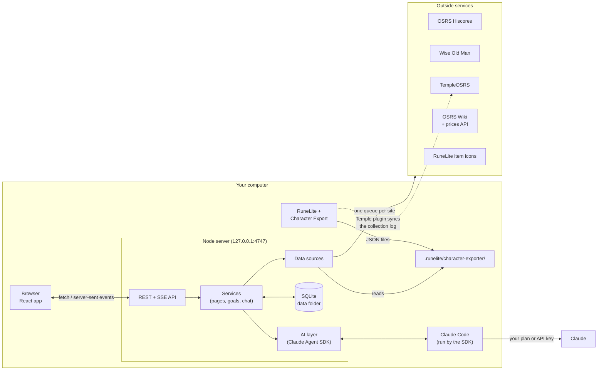
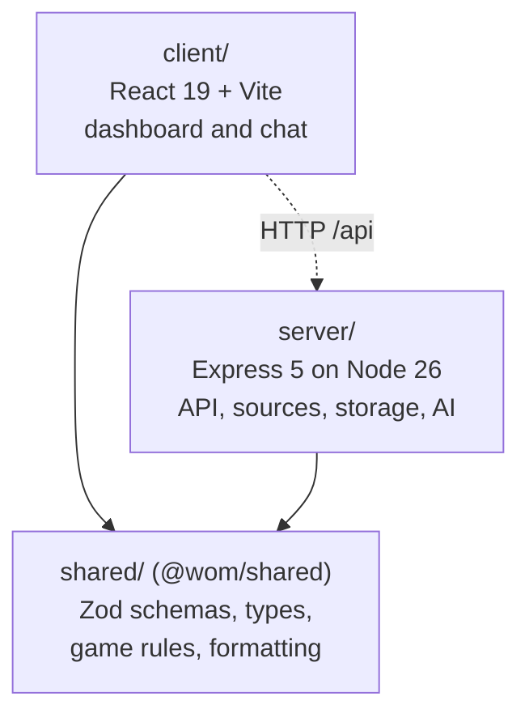
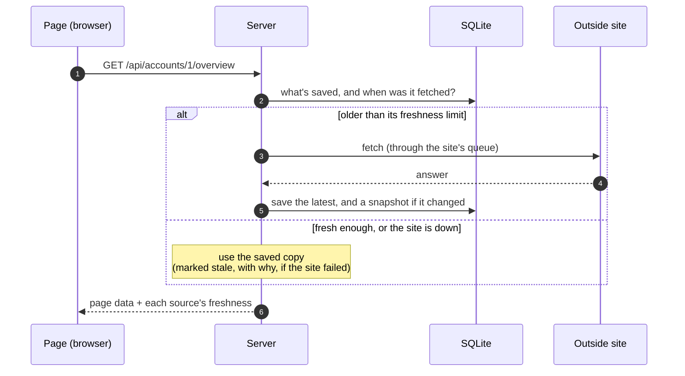
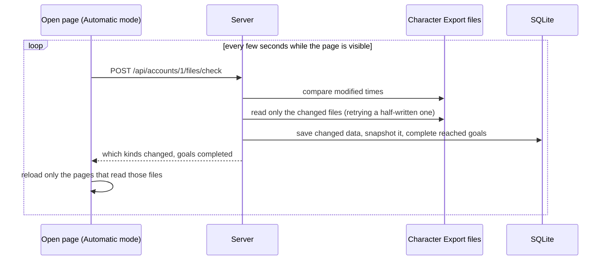
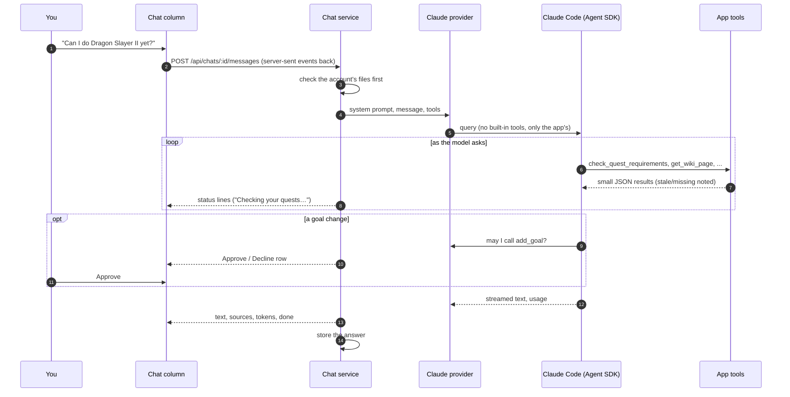

# Architecture

How Wise Old Model is put together, and why. This page covers the whole system; each package has its own page for the detail:

- [server/ARCHITECTURE.md](server/ARCHITECTURE.md): the Express backend, its data sources, storage and the AI layer.
- [client/ARCHITECTURE.md](client/ARCHITECTURE.md): the React app.
- [shared/ARCHITECTURE.md](shared/ARCHITECTURE.md): the schemas and game rules both sides use.

## What it is

A personal, single-user OSRS account advisor that runs on your own computer. It gathers everything known about a handful of your accounts (from the official hiscores, Wise Old Man, TempleOSRS, the OSRS Wiki and files RuneLite writes as you play), keeps its own history of it, and shows it in a dashboard beside a chat with Claude that can look all of it up.

Three constraints shape most of the design:

1. **It's local and single-user.** The server binds to `127.0.0.1` and has no logins. There is no hosting, no multi-user support and no background service: it only does anything while you have it open.
2. **It's a polite client of other people's services.** Every outside site is asked only when its data is actually needed, at a gentle pace, with a User-Agent that says who to contact. The app never automates gameplay.
3. **The AI only interprets.** The model reaches account and game data only through tools the app defines, and every number (XP to go, requirement checks, costs, time estimates) is worked out in code.

## The system at a glance

The server exists for two reasons. The Jagex hiscores send no CORS headers, so a browser can't call them directly. And the AI's credentials (Claude Code's sign-in, or an API key) must never reach the browser.

## Packages

The repo is three npm workspaces:

- **`shared`** holds the API's Zod schemas (each response is checked against the same schema on both sides), the types inferred from them, and pure helpers both sides need: game rules (the XP table, combat level, diary areas), name matching, time zones and number formatting. It has no runtime dependencies beyond Zod.
- **`server`** is TypeScript run directly by Node 26 (type stripping, no build step). It talks to every outside site, reads RuneLite's files, stores everything in SQLite, works out page data and goal progress, and runs the chat.
- **`client`** is a React app built with Vite. In development Vite serves it and forwards `/api` to the server; in production the server serves the built files, so the whole app is one process at one URL.

## How data flows

### Getting data in

Two kinds of data come in, by two different routes.

**Online data** (hiscores, Wise Old Man, Temple, the wiki, prices) is fetched only when something needs it and the saved copy is older than its freshness limit: 15 minutes for the hiscores, an hour for Temple's collection log, a day for most wiki answers, five minutes for prices. Opening a page, asking the chat, or pressing Refresh are the only triggers. There are no scheduled jobs.

**Game data** comes from [Character Export](https://github.com/DZWNK/Character-Export), a RuneLite plugin that writes one JSON file per kind of data (quests, diaries, bank, gear and so on) for each character. The server reads only files whose modified time changed. In Automatic mode an open page asks for that check every few seconds, so the dashboard follows along as you play; in Manual mode only Refresh does.

### Keeping it

Everything lives in one SQLite file in the data folder (the OS's app-data folder by default):

- **The latest copy** of each kind of data per account, with when it was fetched and the last error (`source_state`).
- **History**: whenever data changes, a snapshot of the raw answer is kept (`snapshots`), so parsers can improve later without losing anything, and This week can compare a quest list from Monday with today's. Identical data isn't saved twice.
- **Shared data** not tied to an account, such as wiki pages and prices (`cache`).
- **Goals, chats and settings.**

Raw answers are stored exactly as received, and parsed when read. Backups are made daily at startup and before any migration.

### Showing it

Each page has one endpoint that returns everything it shows, already worked out: the Overview's progress rows, the bank's value, This week's gains. The client renders what it gets and keeps it in TanStack Query's cache, keyed by the API path, so reloading everything about an account is one prefix.

When a source fails, the last good data stays on screen, marked stale with the reason. The chat's tools report the same thing to the model, so its answers say when data is old or missing and how to fix it.

## How the chat works

- The model is reached through a **provider interface**, so nothing outside one module depends on a provider's SDK. The provider used is Claude, through the Claude Agent SDK, which runs Claude Code in the app so usage can bill to your Claude plan. The app never touches the Claude sign-in; Claude Code handles it. An API key is the alternative.
- Claude Code runs with **no built-in tools** (no files, shell or web) and none of your Claude Code settings, plugins or other MCP servers. Its only tools are the app's twenty, served from inside the server.
- Tools that **change data** (adding or updating a goal) need your Approve in the chat. Everything else runs unasked.
- Every tool result is **small and dated**: an `asOf` time, which sources are stale, which files are missing and what to do in game. A result over 8,000 characters is refused, so the model asks for less.
- Each wiki page a tool read is listed under the answer as a source.

## Key decisions

| Decision | Why |
|---|---|
| A local server bound to `127.0.0.1`, checking `Host` and `Origin` | Keeps credentials out of the browser and stops other websites in the same browser from using the API (DNS rebinding, cross-site requests). |
| One shared request handler for every outside site | One place for the User-Agent, per-site pacing (Wise Old Man 3 s apart, others 1 s), Wise Old Man's rate-limit headers and retries. Wise Old Man's limits are shared with its RuneLite plugin. |
| Fetch on demand with freshness limits, no background jobs | Nothing runs when you're not using it, and each site is asked as little as possible. |
| Store raw answers as snapshots | History survives parser changes; third-party formats can be re-read. |
| SQLite through Node's built-in `node:sqlite` and Kysely | No native add-ons to compile, so `npm install` works the same on Windows, macOS, Linux and WSL. |
| Do the math in code, not the model | Requirement checks and estimates are deterministic and testable; the model explains them. |
| A provider interface around the AI | The provider can be swapped without touching tools or the UI. |
| Claude through the Agent SDK, never handling the sign-in | Lets usage bill to your Claude plan while following Anthropic's terms for apps. |
| Zod schemas shared by client and server | The API's shape is defined once and checked on both ends. |
| TypeScript run directly by Node, checked by TypeScript 7 | No server build step; only erasable syntax is used. |

## Running on different systems

It runs on Windows, macOS, Linux and WSL. Development happens on WSL; the finished app is likely to run on Windows.

- npm scripts use only Node and cross-platform tools (`cross-env`), and paths are built with Node's `path`.
- The data folder defaults to `%LOCALAPPDATA%\wise-old-model` on Windows, `~/Library/Application Support/wise-old-model` on macOS and `~/.local/share/wise-old-model` on Linux and WSL (keeping SQLite off the Windows drive, whose file locking isn't reliable from WSL).
- RuneLite's folder defaults to `~/.runelite`. On WSL with RuneLite on Windows it's `/mnt/c/Users/<you>/.runelite`, and on Windows a `.env` with that WSL path still works.
- File watching in development polls modified times, because WSL doesn't deliver change events for files on a Windows drive.
- Moving one checkout between WSL and Windows needs a fresh `npm install`, since some tools ship per-OS binaries.

## Security and privacy

- The server listens on `127.0.0.1` only. Every request must name `localhost` or `127.0.0.1` with the app's port as its `Host`; writes must also carry a matching `Origin`; requests the browser marks as coming from another site are refused unless they're a page navigation.
- Responses forbid framing (`frame-ancestors 'none'`) and cross-origin reads.
- Secrets and paths live in `.env`, which is git-ignored. The Settings page shows only whether an API key is set, never its value.
- What the chat's tools return (account names, stats, bank contents) is sent to the AI provider. Nothing else from the machine is.
- Game icons are Jagex's; they're downloaded on first use into the data folder and never committed.

## Testing

Vitest runs the server, client and shared tests together (`npm test`, or `npm run check` with type checking and lint).

- Server tests run against a fresh in-memory database and fake requesters fed with responses captured once from the real APIs, so no test makes a live request.
- The chat is tested with a scripted fake provider; tests never call Claude.
- Client tests render components against a fake API that fails the test on any request it doesn't expect.

Each package's page describes its own test setup.
