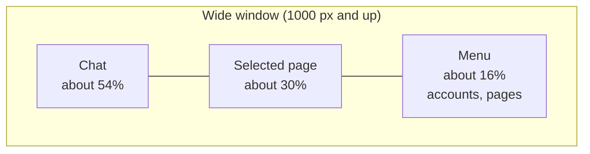
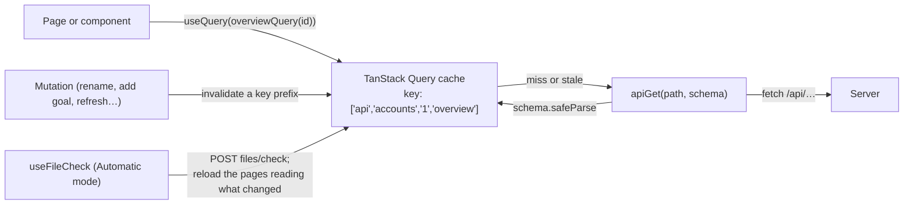
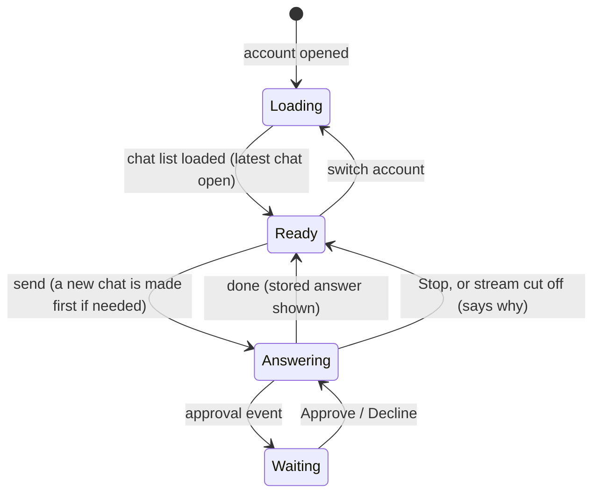

# Client architecture

The React app: a chat-first dashboard for one account at a time. See the [root ARCHITECTURE.md](../ARCHITECTURE.md) for how it fits with the server.

**Stack:** React 19, Vite 8, TanStack Query for server data, React Router for pages, Zod (through `@wom/shared`) to check every API answer, and plain CSS Modules with theme tokens. No component library.

## Contents

- [Folders](#folders)
- [Screen layout](#screen-layout)
- [Routes](#routes)
- [Server data](#server-data)
- [Pages](#pages)
- [The chat](#the-chat)
- [Look and feel](#look-and-feel)
- [Testing](#testing)

## Folders

| Folder | What's in it |
|---|---|
| `main.tsx`, `App.tsx` | Entry point (fonts, theme tokens, the router and query client, made once outside React), and the routes |
| `api/` | `client.ts` (`apiGet`, `apiSend`: fetch, then check the answer with a schema), `queryClient.ts` (`createQueryClient`, `apiQuery`), and each area's queries and mutations: `accounts.ts`, `goals.ts`, `chats.ts`, `about.ts` |
| `layout/` | `Layout.tsx`: the three columns, collapsing on a narrow window |
| `components/` | Shared pieces: `Menu`, `Icon`, `StatsTiles`, `ModalDialog`, `SearchSelect`, `AddAccountDialog`, `AccountTypeSelect`, `ExternalLink`, `Problem`, `PageStates`, `RefreshButton`, and wording helpers (`sourceNotes.ts`, `findings.ts`) |
| `pages/` | One folder per page: `Overview`, `ThisWeek`, `Goals`, `BankGear`, `CollectionLog`, `Settings`; `pageList.ts` holds the menu order and URL ids |
| `chat/` | `useChat.tsx` (the open account's chat and its streaming answer), `ChatColumn.tsx`, `Markdown.tsx` |
| `data/` | `useFileCheck.ts`: in Automatic mode, checks the open account's Character Export files |
| `settings/` | `useSettings.ts` (read and change settings, apply the theme, report the browser's time zone), `useModelChoice.ts` and `ModelOptions.tsx` (the chosen AI's model and effort pickers) |
| `theme/` | `tokens.css` (both themes' colors, fonts and form controls), `fonts.ts` |
| `test/` | Test setup, `fakeApi.ts` (a stand-in for the server) and `renderApp.tsx` |

## Screen layout

Built for a second monitor to the right of the user: the chat on the left as the main feature, the selected page in the middle, and the menu on the right edge next to the page it controls. Below 1000 px the page and menu collapse behind a Menu button above the chat; the panel opens over the chat, closes with Escape or when the focus goes into the chat (as when a page asks the chat something), and keeps its state (scroll, searches, typing) while closed.

A visually hidden `h1` names the app; the page is the `main` landmark, the chat a region headed with the account's name ("Chat about" for screen readers), and the menu the navigation. Each page names the browser tab, as in "Goals – Lumby Pete – Wise Old Model" (`layout/useDocumentTitle.ts`).

## Routes

| URL | Shows |
|---|---|
| `/` | The first account's Overview, or the add-account form until an account exists |
| `/:accountId/:page` | That account's page: `overview`, `this-week`, `goals`, `bank`, `collection-log` or `settings` |
| `/:accountId` or an unknown page | The account's Overview |
| An account that doesn't exist (deleted, mistyped) | Back to `/` |

Each account has its own chat; switching accounts switches both the chat and the page, and hangs up on an answer in progress.

## Server data

- **Queries are keyed by their API path's segments** (`apiQuery('/api/accounts/1/overview', schema)` → `['api', 'accounts', '1', 'overview']`), so invalidating `['api', 'accounts', '1']` reloads everything about account 1.
- **Every answer is checked** with the shared Zod schema; one that doesn't fit is an error, not a crash later.
- **Errors:** a refusal carries the server's own sentence (`{ error }`); a server that can't be reached says so. A 4xx isn't retried; other failures are retried twice. Requests go out even when the browser thinks it's offline, since the server is on the same machine.
- **The file check** (`data/useFileCheck.ts`): while an account is open in Automatic mode, it checks the account's Character Export files at once, then every `pollSeconds` while the page is visible, and as soon as the page is shown again. The pages that read a changed file reload (`reloadPagesReading` in `api/accounts.ts`): Overview, Bank and gear, This week (quests, diaries and combat achievements) and Goals (every file). When the check completed goals, Goals and This week reload too.
- Pages show the last good data with a note when a reload fails, rather than blanking (`components/PageStates.tsx`).

## Pages

| Page | Shows |
|---|---|
| Overview | Name, type, combat and total level; stats tiles like the in-game stats tab (picking one says its experience on a line below); progress rows (quests, diaries, combat achievements, collection log); the top five boss kill counts, expandable; worn gear; what's missing and how to get it; when each source was fetched, Refresh, and a suggested rename |
| This week | Today, 7 days, 30 days or a custom range: a one-line summary, XP per skill with level-ups, kills and clues, what was completed (dated), new collection log items |
| Goals | Add goal and Suggest goals (with why they wait, when they do); active goals in your order (drag, Move up and Move down, or Alt+↑/↓ on either) with progress and what's still needed; Done with dates; Add goal as a dialog picking names from the account's own lists |
| Bank and gear | The bank's value; one search across bank, seed vault, inventory and gear; worn gear in the equipment screen's grid; the 28-slot inventory with stack sizes as the game writes them (picking a slot says what it holds on a line below); the priciest stacks |
| Collection log | Totals and Temple's last sync; tabs like the in-game log; entries (complete ones in green) and the picked entry's items |
| Settings | Accounts (rename, change type, delete after a question), Game data (RuneLite folder, Automatic or Manual and its interval), AI (which AI answers, from those `.env` sets up, each other one saying what it needs; its model and effort; the most tool rounds; Claude's billing and spending cap), Display (theme, time zone), About (data folder, backups, `.env` settings with keys only as set or not, credits) |

Each page gets all its data from one endpoint, already worked out by the server, and renders it.

## The chat

- `useChat(accountId)` holds the account's chat: the chat list, the open chat, its messages and the turn being answered. A message is posted with `fetch`, and its answer read as it streams (`readEvents` with the shared `parseSse`). While it streams, the answer is built from the events and shown as it will be stored; once done, the stored chat replaces it.
- Pages ask the chat things through `useChatAsk()` (Suggest goals, Ask the AI for a plan), which also says why it can't yet ("The chat is answering."). Asking moves the focus into the chat, which closes the narrow window's panel so the answer shows.
- **The column:** the account's name, New chat and Earlier chats (open, rename, delete; it closes when the focus moves on past it or its button); your messages with any note ("From Goals"); each answer's lookups as one line ("Looked at 4 things") that opens to each lookup with its icon; the answer's Markdown in the serif (`Markdown.tsx`: headings, lists, tables, bold, italics, code, and links that open in a new tab; HTML shown as text); Approve / Decline rows; problems with what to do; sources and token usage under each answer; and the message box (Enter sends, Shift+Enter for a new line) with the labelled model and effort pickers (and why the models couldn't be listed, when they couldn't) and Stop.
- **Scrolling:** the chat follows the newest while you're at the end. Scrolled up to read, it stays where it is, and a New message button floats over the bottom when the answer gets something out of sight below; it goes to the answer's start, and goes away once you've seen that. Sending (from the box, a starter or a page) and opening a chat go to the end.
- The model and effort lists come from the chosen AI through `GET /api/chat/models?provider=&billing=`, one list per AI (Claude's per billing), so switching AI in Settings lists the new one's and shows the model and effort picked for it (`useModelChoice`, shared with Settings → AI). An AI with no model picked shows the one it answers with then. Switching to a model without the current effort picks the nearest level it has; a model with no effort setting has no effort picker.
- A setup problem names the AI it came from ("Gemini isn't available yet", then what to do and what it said), and usage reads as Claude's billing has it ("8.2k tokens on your plan", "$0.04 with your API key") or, for another AI, its tokens and the cost when it gave one ("8.2k tokens ($0.03)").
- After an answer that changed goals (it ran `add_goal` or `update_goal`, or its file check completed some), Goals and This week reload.

## Look and feel

"Stone and lantern": the game's own interface, refined. Colors and fonts are tokens on `:root` in `theme/tokens.css`, set per theme with `<html data-theme>`.

| | Dark (default) | Light (parchment) |
|---|---|---|
| Background, panel, raised | `#1f1c17`, `#28231c`, `#332c22` | `#f1eada`, `#e8e0cb`, `#dcd0b3` |
| Rules (dividers, button and panel edges) | `#4a4134` | `#a8956b` |
| Control edges (boxes to type in or pick from) | `#85755d` | `#83724d` |
| Text, muted | `#ebe1ca`, `#c3baa8` | `#2b2116`, `#473b2a` |
| Accent | `#ffa73f` (after the game's orange) | `#632e00` |
| Not started, in progress, done | `#f0a99c`, `#e9d44b`, `#6dcf79` | `#702114`, `#4b3b00`, `#1a451e` |

- **Type:** Alegreya (serif) for chat answers and headings, Alegreya Sans for the interface, Silkscreen (pixel) only for skill levels. Fonts are bundled through Fontsource, not loaded from Google.
- **The one loud element** is the stats tiles, styled like the in-game stats tab (yellow pixel levels on stone in dark; dark amber on parchment in light).
- **Status colors** follow the in-game quest list (red, yellow, green). Like text and muted text, each passes 7:1 on the background, panels and raised surfaces, so the colors sit close in lightness: hierarchy comes more from size and weight.
- **No template chrome:** sentence case everywhere, no all-caps labels, no middle-dot meta strings, no arrows on buttons.
- The last theme is also kept in `localStorage`, so `index.html` applies it before the app loads and a light page doesn't flash dark.
- **Icons** (`components/Icon.tsx`) come from the server: wiki images by file name (`/api/icons/wiki/Attack_icon.png`) and RuneLite item icons by id (`/api/icons/item/4151`), pixel art kept sharp; a missing icon leaves a blank of its size.
- **Accessibility:** native elements first (`<dialog>`, `<fieldset>`, form controls), ARIA patterns where needed (tabs in the Collection log, a combobox for `SearchSelect`), problems announced as they appear (`role="alert"`), and focus moved deliberately when something it was on disappears.
- **WCAG 2.2 AAA** is the aim:
  - Text is at 7:1 or more; control edges and the focus ring are at 3:1. `theme/contrast.test.ts` checks every text and edge color in both themes.
  - Nothing is told by color alone. A picked item is bold, with an accent bar (menu link, tab, entry, open chat) or a thicker accent edge (period chip, collection log item). A goal's status has a shape (● not met, ◐ under way).
  - Windows contrast themes (forced colors) keep the goal bar.
  - Everything to click or tap is at least 44 × 44 px (`tokens.css` sets it for buttons, selects and boxes, and a checkbox's label takes the clicks for it); only links inside a sentence are smaller.
  - Text is set for reading: lines 1.5 apart; paragraphs one after another 1.5em apart (answers, Settings, problems); no paragraph wider than `55ch`, about 75 characters, since a "0" (which `ch` measures) is wider than the average letter, except in answers, which take the chat's full width by choice (so they can run past 1.4.8's 80 characters); font sizes in `rem`; and names wrapping (hyphenated in the stats tiles) rather than cut off with an ellipsis.
  - Nothing is said only in a tooltip, which keys and touch can't reach: a skill's experience and a bank slot's contents show on a line below when it's picked (the bank's lines aren't read out, as each slot's name says the same), why a button waits shows beside it, a model's description and what effort means show under their pickers in Settings, and what a field wants shows under it.
  - Links to other sites, which open in a new tab, say so: a mark for the eye and "(opens in a new tab)" for screen readers (`ExternalLink`).
  - Goals move without dragging, by Move up and Move down. Buttons that can't act yet (the end of the list, Refresh while it works) use `aria-disabled`, so the focus stays on them; Refresh's status line says when it's done.
  - Focus rings are 2 px everywhere, including round the message box and on the option a search picker's arrow keys are on. Nothing floating covers what has focus: Earlier chats closes when the focus moves past it or its button, the messages scroll clear of New message, and a collection log item scrolls clear of the picked item's line, even when that wraps to three lines.

## Testing

- Component tests (Vitest with jsdom and Testing Library) cover pages and components with logic: streaming and approvals, goal progress, the pickers, settings.
- `test/fakeApi.ts` stands in for the server: routes are keyed by method and path, settings are served and recorded (each AI keeping its own model and effort, as on the server), and any request a test didn't expect fails it. It also holds test data (`LUMBY_PETE`, `testOverview`, `testAbout`, `TEST_MODELS`, `TEST_PROVIDERS`, `minutesAgo`).
- `test/renderApp.tsx` renders the whole app at a path; tests use the app's own query client without retries.
- jsdom can't check layout, so CSS-only changes are checked by eye. Colors are the exception: `theme/contrast.test.ts` reads `tokens.css` and checks each pair's contrast.
