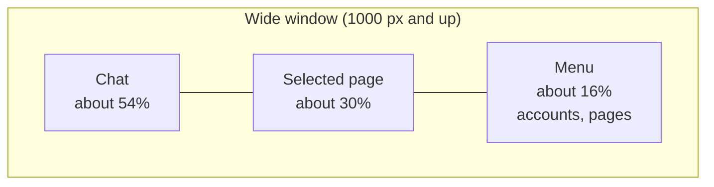
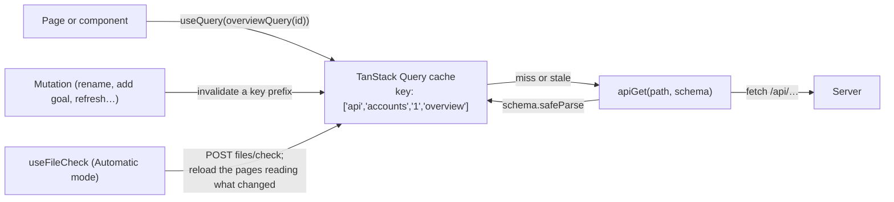
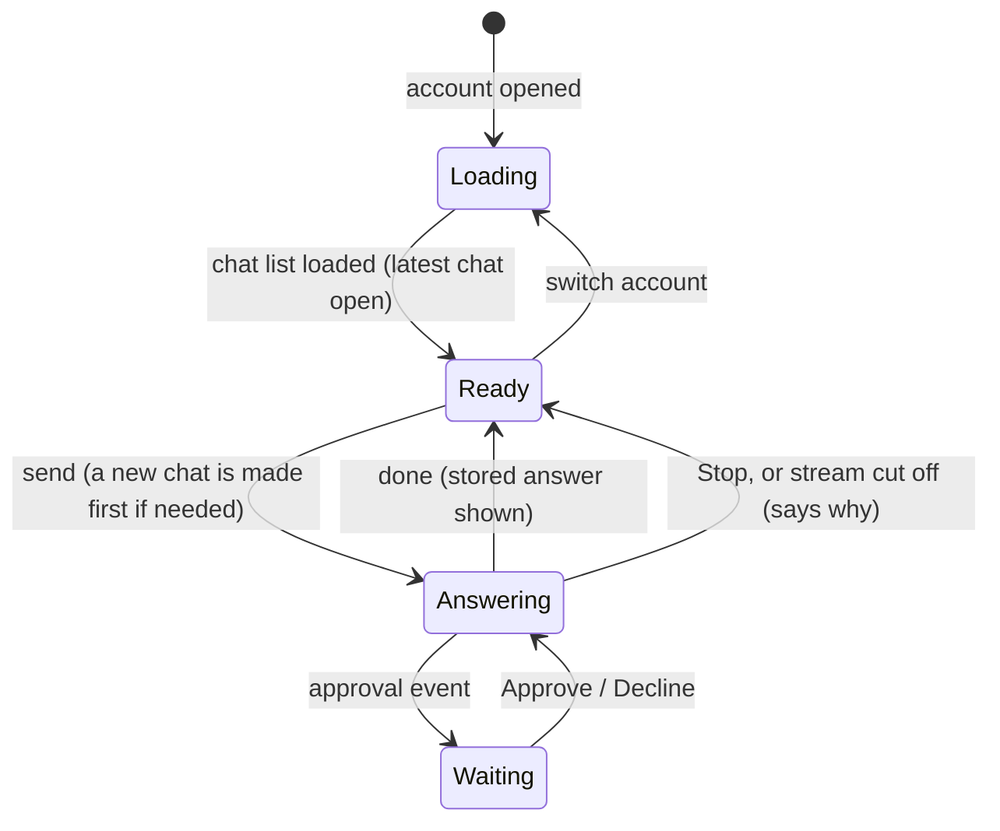

# Client architecture

The React app: a chat-first dashboard for one account at a time. See the [root ARCHITECTURE.md](../ARCHITECTURE.md) for how it fits with the server.

**Stack:** React 19, Vite 8, TanStack Query for server data, React Router for pages, Zod (through `@wom/shared`) to check every API answer, and plain CSS Modules with theme tokens. No component library.

## Folders

| Folder | What's in it |
|---|---|
| `main.tsx`, `App.tsx` | Entry point (fonts, theme tokens, the router and query client, made once outside React), and the routes |
| `api/` | `client.ts` (`apiGet`, `apiSend`: fetch, then check the answer with a schema), `queryClient.ts` (`createQueryClient`, `apiQuery`), and each area's queries and mutations: `accounts.ts`, `goals.ts`, `chats.ts`, `about.ts` |
| `layout/` | `Layout.tsx`: the three columns, collapsing on a narrow window |
| `components/` | Shared pieces: `Menu`, `Icon`, `StatsTiles`, `ModalDialog`, `SearchSelect`, `AddAccountDialog`, `AccountTypeSelect`, `ExternalLink`, `Problem`, `PageStates`, `RefreshButton`, and wording helpers (`sourceNotes.ts`, `findings.ts`) |
| `pages/` | One folder per page: `Overview`, `ThisWeek`, `Goals`, `BankGear`, `CollectionLog`, `Settings`; `pageList.ts` holds the menu order and URL ids |
| `chat/` | `useChat.tsx` (the open account's chat and its streaming answer), `ChatColumn.tsx`, `Markdown.tsx` |
| `data/` | `useFileCheck.ts`: in Automatic mode, checks the open account's Character Export files |
| `settings/` | `useSettings.ts` (read and change settings, apply the theme, report the browser's time zone), `useModelChoice.ts` and `ModelOptions.tsx` (the model and effort pickers) |
| `theme/` | `tokens.css` (both themes' colors, fonts and form controls), `fonts.ts` |
| `test/` | Test setup, `fakeApi.ts` (a stand-in for the server) and `renderApp.tsx` |

## Screen layout

Built for a second monitor to the right of the user: the chat on the left as the main feature, the selected page in the middle, and the menu on the right edge next to the page it controls. Below 1000 px the page and menu collapse behind a Menu button above the chat; the panel opens over the chat, closes with Escape or when the focus goes into the chat (as when a page asks the chat something), and keeps its state (scroll, searches, typing) while closed.

## Routes

| URL | Shows |
|---|---|
| `/` | The first account's Overview, or the add-account form until an account exists |
| `/:accountId/:page` | That account's page: `overview`, `this-week`, `goals`, `bank`, `collection-log` or `settings` |
| `/:accountId` or an unknown page | The account's Overview |
| An account that doesn't exist (deleted, mistyped) | Back to `/` |

Each account has its own chat; switching accounts switches both the chat and the page, and hangs up on an answer in progress.

## Server data

- **Queries are keyed by their API path's segments** (`apiQuery('/api/accounts/1/overview', schema)` → `['api', 'accounts', '1', 'overview']`), so invalidating `['api', 'accounts', '1']` reloads everything about account 1.
- **Every answer is checked** with the shared Zod schema; one that doesn't fit is an error, not a crash later.
- **Errors:** a refusal carries the server's own sentence (`{ error }`); a server that can't be reached says so. A 4xx isn't retried; other failures are retried twice. Requests go out even when the browser thinks it's offline, since the server is on the same machine.
- **The file check** (`data/useFileCheck.ts`): while an account is open in Automatic mode, it checks the account's Character Export files at once, then every `pollSeconds` while the page is visible, and as soon as the page is shown again. The pages that read a changed file reload (`reloadPagesReading` in `api/accounts.ts`): Overview, Bank and gear, This week (quests, diaries and combat achievements) and Goals (every file). When the check completed goals, Goals and This week reload too.
- Pages show the last good data with a note when a reload fails, rather than blanking (`components/PageStates.tsx`).

## Pages

| Page | Shows |
|---|---|
| Overview | Name, type, combat and total level; stats tiles like the in-game stats tab; progress rows (quests, diaries, combat achievements, collection log); the top five boss kill counts, expandable; worn gear; what's missing and how to get it; when each source was fetched, Refresh, and a suggested rename |
| This week | Today, 7 days, 30 days or a custom range: a one-line summary, XP per skill with level-ups, kills and clues, what was completed (dated), new collection log items |
| Goals | Add goal and Suggest goals; active goals in your order (drag, or Alt+↑/↓ on the handle) with progress and what's still needed; Done with dates; Add goal as a dialog picking names from the account's own lists |
| Bank and gear | The bank's value; one search across bank, seed vault, inventory and gear; worn gear in the equipment screen's grid; the 28-slot inventory with stack sizes as the game writes them; the priciest stacks |
| Collection log | Totals and Temple's last sync; tabs like the in-game log; entries (complete ones in green) and the picked entry's items |
| Settings | Accounts (rename, change type, delete after a question), Game data (RuneLite folder, Automatic or Manual and its interval), AI (billing, model, effort, limits), Display (theme, time zone), About (data folder, backups, `.env` settings, credits) |

Each page gets all its data from one endpoint, already worked out by the server, and renders it.

## The chat

- `useChat(accountId)` holds the account's chat: the chat list, the open chat, its messages and the turn being answered. A message is posted with `fetch`, and its answer read as it streams (`readEvents` with the shared `parseSse`). While it streams, the answer is built from the events and shown as it will be stored; once done, the stored chat replaces it.
- Pages ask the chat things through `useChatAsk()` (Suggest goals, Ask the AI for a plan), which also says why it can't yet ("The chat is answering."). Asking moves the focus into the chat, which closes the narrow window's panel so the answer shows.
- **The column:** the account's name, New chat and Earlier chats (open, rename, delete); your messages with any note ("From Goals"); each answer's lookups as one line ("Looked at 4 things") that opens to each lookup with its icon; the answer's Markdown in the serif (`Markdown.tsx`: headings, lists, tables, bold, italics, code, and links that open in a new tab; HTML shown as text); Approve / Decline rows; problems with what to do; sources and token usage under each answer; and the message box (Enter sends, Shift+Enter for a new line) with the model and effort pickers and Stop.
- The model and effort lists come from Claude Code through `GET /api/chat/models`, one list per billing (`useModelChoice`, shared with Settings → AI). Switching to a model without the current effort picks the nearest level it has.
- After an answer that changed goals (it ran `add_goal` or `update_goal`, or its file check completed some), Goals and This week reload.

## Look and feel

"Stone and lantern": the game's own interface, refined. Colors and fonts are tokens on `:root` in `theme/tokens.css`, set per theme with `<html data-theme>`.

| | Dark (default) | Light (parchment) |
|---|---|---|
| Background, panel, raised | `#1f1c17`, `#28231c`, `#393227` | `#e4d8b9`, `#dacdab`, `#cdbd94` |
| Rules | `#4a4134` | `#a8956b` |
| Text, muted | `#ebe1ca`, `#a89a80` | `#2b2116`, `#6b5a40` |
| Accent | `#ff981f` (the game's orange) | `#8f4300` |
| Not started, in progress, done | `#e5654f`, `#e9d44b`, `#3fbf4f` | `#9e2f1c`, `#6b5400`, `#25622a` |

- **Type:** Alegreya (serif) for chat answers and headings, Alegreya Sans for the interface, Silkscreen (pixel) only for skill levels. Fonts are bundled through Fontsource, not loaded from Google.
- **The one loud element** is the stats tiles, styled like the in-game stats tab (yellow pixel levels on stone in dark; dark amber on parchment in light).
- **Status colors** follow the in-game quest list (red, yellow, green), each passing 4.5:1 contrast so they can color text.
- **No template chrome:** sentence case everywhere, no all-caps labels, no middle-dot meta strings, no arrows on buttons.
- The last theme is also kept in `localStorage`, so `index.html` applies it before the app loads and a light page doesn't flash dark.
- **Icons** (`components/Icon.tsx`) come from the server: wiki images by file name (`/api/icons/wiki/Attack_icon.png`) and RuneLite item icons by id (`/api/icons/item/4151`), pixel art kept sharp; a missing icon leaves a blank of its size.
- **Accessibility:** native elements first (`<dialog>`, `<fieldset>`, form controls), ARIA patterns where needed (tabs in the Collection log, a combobox for `SearchSelect`), problems announced as they appear (`role="alert"`), and focus moved deliberately when something it was on disappears.

## Testing

- Component tests (Vitest with jsdom and Testing Library) cover pages and components with logic: streaming and approvals, goal progress, the pickers, settings.
- `test/fakeApi.ts` stands in for the server: routes are keyed by method and path, settings are served and recorded, and any request a test didn't expect fails it. It also holds test data (`LUMBY_PETE`, `testOverview`, `testAbout`, `TEST_MODELS`, `minutesAgo`).
- `test/renderApp.tsx` renders the whole app at a path; tests use the app's own query client without retries.
- jsdom can't check layout, so CSS-only changes are checked by eye.
