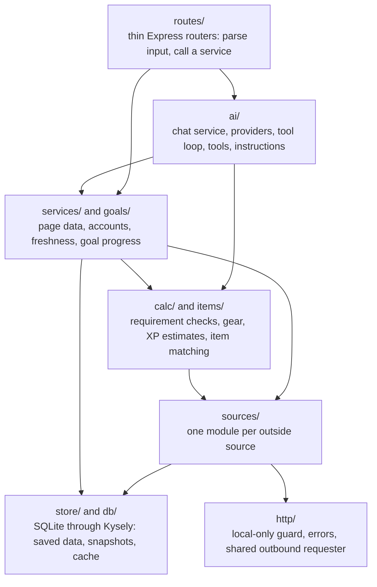
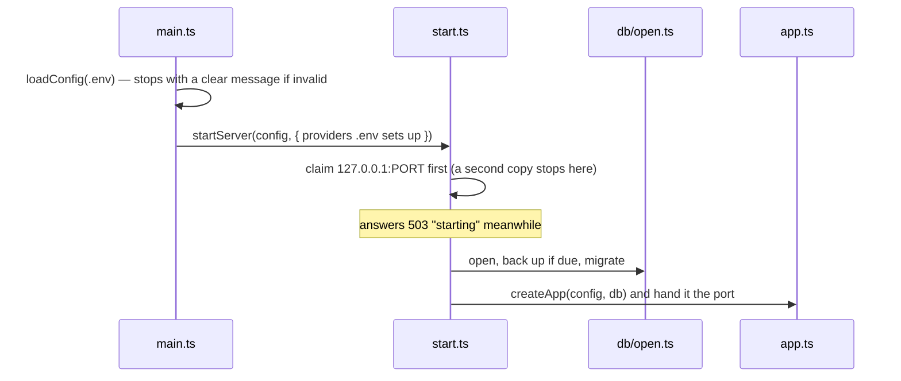
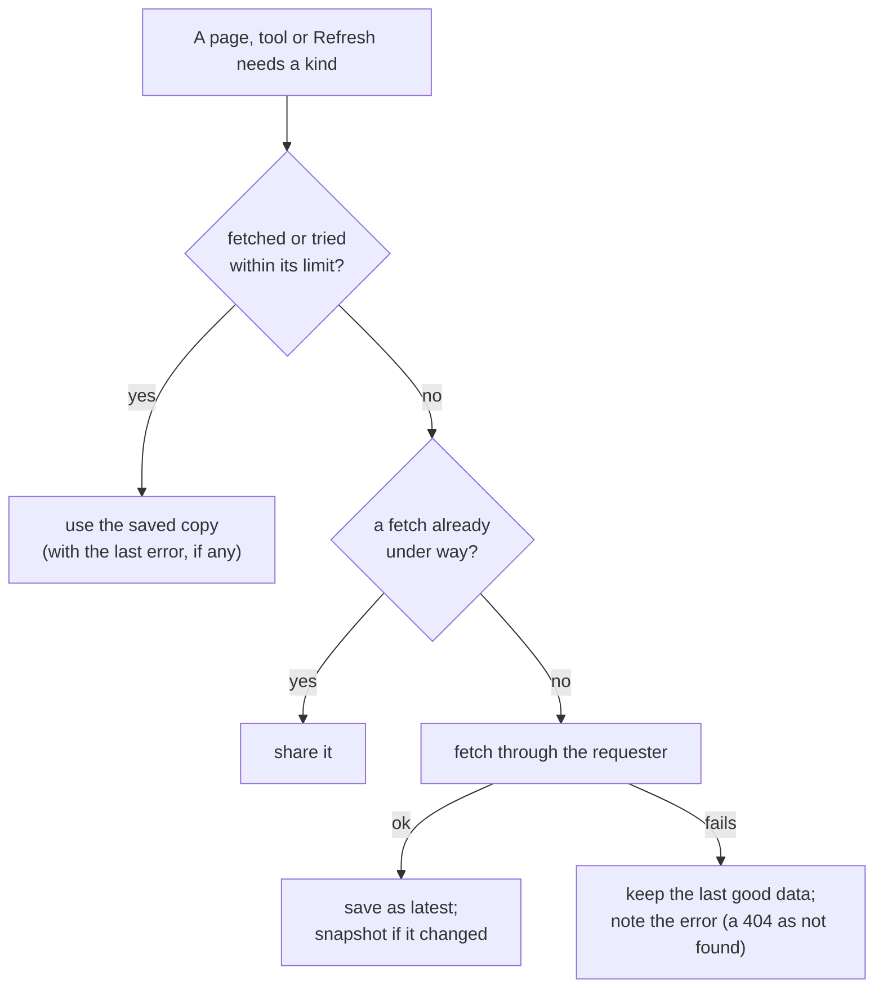
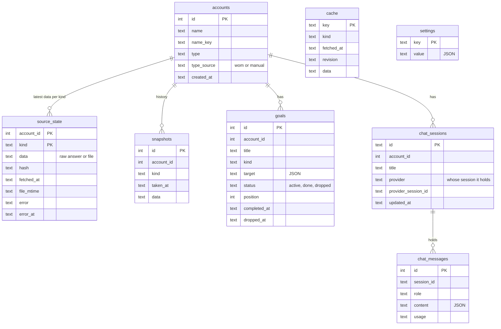
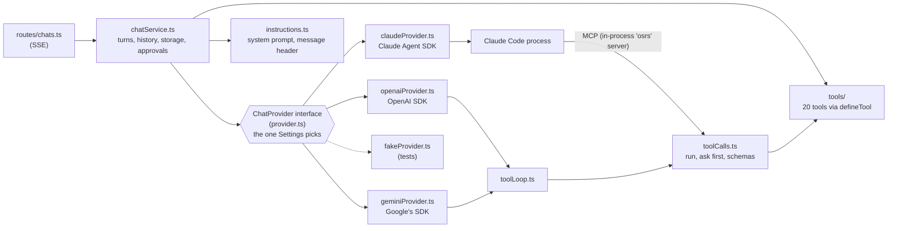

# Server architecture

The backend: an Express 5 app on Node 26 that talks to every outside site, reads RuneLite's files, keeps everything in SQLite, works out what each page shows, and runs the chat. See the [root ARCHITECTURE.md](../ARCHITECTURE.md) for how it fits with the client.

TypeScript runs directly on Node (type stripping, no build step), so the code uses only erasable syntax (no enums, namespaces or parameter properties) and relative imports end in `.ts`. TypeScript 7 only type-checks.

## Layers

| Folder | What's in it |
|---|---|
| `main.ts`, `start.ts`, `app.ts`, `config.ts`, `dev.ts`, `watch.ts` | Entry point, startup, the Express app, `.env` handling, and the development restarter |
| `http/` | `localOnly.ts` (the request guard), `errors.ts` (JSON errors), `listen.ts`, `requester.ts` (every outbound request) |
| `sources/` | `hiscores.ts`, `wom.ts`, `temple.ts`, `wiki.ts`, `prices.ts`, `icons.ts`, `characterExport.ts` (+ its schemas), and `answers.ts` (fetch-and-check helpers they share) |
| `store/` | `sourceState.ts` (each account's latest data and its history), `cache.ts` (shared data such as wiki pages and prices) |
| `db/` | `open.ts`, `migrations.ts`, `schema.ts`, `backup.ts`, and `nodeSqliteDialect.ts` (Kysely over `node:sqlite`) |
| `services/` | `freshness.ts` (when to fetch), `accounts.ts` (lookup, add, rename, delete, refresh), `overview.ts`, `bank.ts`, `gains.ts`, `collectionLog.ts`, `itemInfo.ts`, `accountData.ts` (everything saved for an account, for goals and the AI) |
| `calc/` | `requirements.ts` (quest and diary checks, quest points), `gear.ts` (recommended gear and upgrades), `estimates.ts` (hours to a target XP), `combatAchievements.ts` |
| `items/` | `itemIndex.ts` (loose name search), `itemNames.ts` (name keys, owned-item matching), `itemStats.ts` (equipment stats from the wiki) |
| `goals/` | `progress.ts` (how far a goal is), `goalsService.ts` (the Goals page, adding, changing, ordering, completing) |
| `ai/` | `provider.ts` (the interface), `providers.ts` (the ones `.env` sets up), `providerInfo.ts` (every AI as Settings lists it, without their SDKs), `claudeProvider.ts`, `openaiProvider.ts`, `geminiProvider.ts`, `toolLoop.ts` (the tool loop for API providers), `toolCalls.ts` (running and approving tool calls, tool schemas), `fakeProvider.ts` (tests), `chatService.ts`, `instructions.ts`, `tools/` |
| `routes/` | `accounts.ts`, `goals.ts`, `chats.ts`, `settings.ts` (with About and backups), `icons.ts` |
| `settings/` | `settingsRepo.ts`: settings stored one row each |
| `../test/helpers.ts` | Test helpers: temp folders, test configs and databases, a real HTTP `call`, fake requesters, fixtures |

## Startup and the HTTP layer

- **Config** (`config.ts`): `CONTACT` is required (it goes in the User-Agent, so plain ASCII only). Folder settings accept `~`, turn a WSL path like `/mnt/c/...` into `C:\...` on Windows, and refuse anything that wouldn't work on this OS (a Linux path on Windows, a relative path), saying what to write instead. An AI's settings without the one that turns it on (`OPENAI_COMPAT_API_KEY` without `OPENAI_COMPAT_BASE_URL`, `GEMINI_MODEL` without `GEMINI_API_KEY`) are refused rather than ignored, as is a base URL that isn't http(s) or holds a user name or password.
- **The guard** (`http/localOnly.ts`): `Host` must be `localhost:<port>` or `127.0.0.1:<port>` (also Vite's 5173 in development), which blocks DNS rebinding. Requests the browser marks as cross-site or same-site are refused unless they're a page navigation, and anything but GET or HEAD must carry a matching `Origin`. Failures are a 403 explaining why.
- **Headers:** `frame-ancestors 'none'`, `X-Frame-Options: DENY`, `nosniff`, `Cross-Origin-Resource-Policy: same-origin`.
- **Errors** (`http/errors.ts`) are written in one place, the last middleware, always as `{ "error": "..." }`. Routes throw an `HttpError(status, message)`, or `parseInput(schema, value)` turns bad input into a 400 with Zod's message. A `SourceError` (an outside site failing) becomes a 502 with its message. Anything else is a 500 whose details stay in the server's console.
- **In production** the server also serves `client/dist`; a path without a file extension gets `index.html`, and if the client isn't built, pages answer 503 with what to run.
- **In development** `dev.ts` runs `main.ts` and restarts it when server or shared code changes, polling modified times once a second (WSL gives no change events for files on a Windows drive).

## Talking to other sites

Every request to a data source goes through `createRequester` (`http/requester.ts`). (The AI providers are the exception: each talks through its own SDK, as their answers stream for minutes and each SDK knows its API. See The AI layer.) It:

- sends `wise-old-model/<version> (personal use; contact: <CONTACT>)` as the User-Agent (the wiki blocks generic ones);
- keeps one queue per site: Wise Old Man requests at least 3 s apart, every other site 1 s, on a clock that only moves forward;
- pauses Wise Old Man when its `RateLimit-Remaining` runs low, until `RateLimit-Reset` (its 20/min, 500/h and 3,000/day per-IP limits are shared with the Wise Old Man RuneLite plugin);
- retries 429s, 5xx errors and lost connections up to 3 times (1, 2, then 4 s, or as `Retry-After` says), gives each request 20 s, and never waits more than a minute: a longer wait fails at once with the site's status ("Try again in 20 hours");
- names the site in every error (`Wise Old Man: server error (500)`) and adds the site's own reason when it gives one. A 404 is a separate `NotFoundError`.

Sources build on two helpers in `sources/answers.ts`: `fetchChecked` fetches and checks an answer parses (a maintenance page can arrive with a 200), returning both the text to store and the parsed value; `readSaved` parses a stored answer back.

### The sources

The endpoints below were checked against the live APIs on 2026-10-27; recheck an API's docs before relying on anything not listed.

| Source | Module | What the app uses | Kept for |
|---|---|---|---|
| OSRS Hiscores | `hiscores.ts` | `m=hiscore_oldschool/index_lite.json?player=<name>`: skills and activities (bosses, clues, "Collections Logged"), in the order given, so new skills appear without code changes | 15 min |
| Wise Old Man | `wom.ts` | `/players/:name` (type, EHP, EHB, boss kills), `/gained` (by period or dates), `/achievements`, `/names` (name changes), `/efficiency/rates` | 15 min; rates 1 day |
| TempleOSRS | `temple.ts` | The whole collection log with names and missing items; `categories.php` for each entry's tab | 1 hour; categories 1 day |
| OSRS Wiki | `wiki.ts` | Search, page sections and wikitext, Bucket queries (quests, recommended gear, item stats, drops), template expansion | Pages until they change (rechecked daily); the rest 1 day |
| Wiki prices | `prices.ts` | `/api/v2/osrs/mapping` (every tradeable item) and `/latest` (every item's last trades), bulk only | 1 day / 5 min |
| Icons | `icons.ts` | Wiki images by file name, RuneLite's item icons by id | Forever, as files |
| Character Export | `characterExport.ts` | The plugin's JSON files in the RuneLite folder | Re-read when changed |

A few rules worth knowing:

- **Wise Old Man is never updated automatically.** Refresh asks it to update a player only when its data is over an hour old, and never for a player it doesn't track (that would start tracking them; the add-account dialog offers that instead).
- Efficiency rates follow the account type: `main` for regular, `ultimate`, and `ironman` for every other iron type. `hoursToTarget` (`calc/estimates.ts`) walks a skill's XP brackets the way Wise Old Man's own algorithm does.
- Hiscores answers keep unranked entries (`rank: -1`); an unranked skill still has its real level and XP. Account types use different hiscores tables, which nest (every account is on the main table, so stats come from there).
- Temple's times are UTC without saying so. A player who never synced gets Temple's error 402, which the app treats as "no log yet". The log is compared without its rank and sync time, so only a changed log adds a snapshot.
- Wiki titles are normalized (spaces, a capital first letter), redirects followed, and each page part is cached with its revision id. A day-old page is checked with one `latestRevisions` request for up to 50 pages, and downloaded again only if it changed. Section text is turned into plain lines (tables as `cell | cell`) and cut at 4,000 characters.
- Prices can exceed 2³¹, so they stay JavaScript numbers (exact to 2⁵³).

## Freshness: when to fetch

`ensureFresh` (`services/freshness.ts`) decides, per account and kind, whether to fetch. It knows nothing about any one source: each kind has a fetcher, and a small table says which kinds wait for another on Refresh (Wise Old Man's gains and achievements wait for its player answer).

- A failed attempt counts toward the limit like a fetch, so a site that's down (or doesn't know the name) isn't asked again on every page load. Failures are remembered in memory while the server runs, including for a kind never fetched.
- **Refresh** ignores the limits, but never fetches a kind again within a minute.
- This week's ranges other than the week (today, 30 days, custom dates) aren't saved with the account; they're kept 15 minutes in memory (`remembered`) under the same rules.

### Shared data cache

Data not tied to an account lives in the `cache` table through `cachedEntry` (`store/cache.ts`), and `cachedFor` (`sources/wiki.ts`) for the wiki, prices, Temple's categories and Wise Old Man's rates. A saved copy is served while it's within its limit; when the site fails, it's served however old along with the failure. A failure stands for a minute, and a load already under way is shared.

Two layers avoid repeated parsing while you play (the Goals and Bank pages reload with every changed file):

- `parsedOnce` parses a whole table (every quest's requirements, the quest list's points, a diary page) once per cached copy.
- A cached row of 64 KB or more (the prices are about a megabyte) is turned back from JSON once per copy and shared.

Whole tables are fetched once and reused rather than queried per question, so requirement checks and item lookups need no wiki requests while the copies are fresh.

## Character Export

[Character Export](https://github.com/DZWNK/Character-Export) (a Plugin Hub plugin, BSD 2-Clause, no network code) writes JSON files to `<RUNELITE_DIR>/character-exporter/<character name>/`.

| File | Written when | Holds |
|---|---|---|
| `character.json` | Login, any stat change | Levels and XP |
| `quests.json` | Login, quest change | Every quest's state |
| `diaries.json` | Login, change, journal opened | 12 areas × 4 tiers, task names once a journal is opened |
| `combat_achievements.json` | Login, change | Every task, by tier |
| `bank.json`, `seed_vault.json` | When opened | Full contents |
| `inventory.json`, `equipment.json` | On change | Carried and worn items |

- **Reading** (`checkFiles`): only files whose modified time changed are read. The plugin overwrites in place, so a file that isn't valid JSON yet is retried 250 ms later, three tries in all; one still unreadable keeps the data from before and is noted as failed. The schemas (`characterExport.schemas.ts`) check the fields the app reads and keep any others, and the raw text is what's stored.
- **Folders** are found by name key, so a name written with a non-breaking space or underscores matches; of two matches, the one written to last wins.
- **A rewrite that only moved the export time** isn't a change and adds no snapshot.
- **Diary task names** only appear after opening that area's journal, and later exports can drop them. `mergeDiaryNames` keeps the most recent names seen in the history, dated, and flags them stale once the tier's task count moves. A tier counts as done by its named tasks while they're current, else by the plugin's flag.
- `collection_log.json` only covers entries opened in game, so the collection log comes from Temple instead.
- The plugin limits how often it saves each file and drops changes that come too soon; Sync Available in its side panel catches up.
- **Modes:** in Automatic mode an open page calls `POST /files/check` every few seconds (`pollSeconds`); in Manual mode only Refresh reads files. A chat message always checks first, so answers never use older data than what's on disk.

## Storage

- **Saving** (`saveSource` in `store/sourceState.ts`) writes the latest copy and, in the same transaction, adds a snapshot when a SHA-256 of the data (or of a text the source gives to compare, leaving out what moves without the data changing) differs.
- **History kept:** every change for stats and progress (hiscores, Wise Old Man's player, Temple's log, quests, diaries, combat achievements, the character file); one a day for the bank and seed vault; latest only for inventory, worn gear and Wise Old Man's gains and achievements.
- **Names** match ignoring case, with spaces, underscores, hyphens and non-breaking spaces the same (`nameKey`). A rename keeps the account's id, so its history stays.
- **Times** are stored as ISO 8601 UTC text. Day-based rules use the time zone from the settings.
- **Deleting an account** deletes everything it owns (foreign keys cascade).
- **The file** is `wise-old-model.db` in the data folder, opened through `node:sqlite` with a small Kysely dialect of our own (`nodeSqliteDialect.ts`). Write-ahead logging with `synchronous = NORMAL`; a write waits up to 5 s for a lock.
- **Migrations** (`db/migrations.ts`) run at startup, all pending ones in one transaction, with a foreign-key check before committing.
- **Backups** (`db/backup.ts`) are full copies made with `VACUUM INTO` into `backups/`: at startup when the newest is over a day old, before any migration (which must succeed first), and on Back up now. The newest 7 are kept.
- **Settings** are one row each, as JSON; a value no longer valid falls back to its default. The model and effort are each AI's own, stored as `model:<provider>` and `effort:<provider>`, so switching AI brings back what was picked for it; the API reads and writes them as plain `model` and `effort`, meaning the chosen AI's. Secrets and paths stay in `.env`.

## Page data

Each page has one service that returns everything it shows. They read saved data, fetch what's past its freshness limit first, and report each source's freshness.

| Service | Page | Notes |
|---|---|---|
| `overview.ts` | Overview | Levels, top kill counts (bosses told apart by Wise Old Man's boss list), progress rows (quests, diary tiers, combat achievement points against the wiki's thresholds, collection log), worn gear, what's missing |
| `gains.ts` | This week | Wise Old Man's XP and kill gains; quests, diaries and combat achievements done, from our own snapshots; new collection log items, from Temple's dates; goals done |
| `bank.ts` | Bank and gear | The bank's value (latest instant-buy price, else instant-sell, else the wiki's value; coins at face value), a search across every place, worn gear, inventory |
| `collectionLog.ts` | Collection log | Temple's log, each entry in its tab |
| `accounts.ts` | Menu, Settings, add dialog | Lookup before adding, add, rename, change type, delete, Refresh (including the rename check), each account's status for Settings |
| `accountData.ts` | Goals, AI tools | Everything saved for an account in one normalized shape: levels (the newer of the hiscores and the character file), quests, diaries, combat achievements, owned items, Temple's log |
| `itemInfo.ts` | AI tools | An item's stats, price, buy limit and likeliest drop sources |

### Calculations

- **Requirement checks** (`calc/requirements.ts`): every quest's requirements come from one Quest Bucket query; a diary's from its page's task table. Lines the parser can't turn into a checkable requirement (alternatives, conditions, items) are kept as plain text and listed as unchecked, rather than guessed. Quest points are worked out from the wiki's quest list, since no source gives them.
- **Gear** (`calc/gear.ts`): a boss's recommended gear (from `<boss>/Strategies`) against what's owned in any state (charged, ornamented, degraded), up to three better items per slot within a budget, buyable only for accounts that can trade.
- **XP and time** (`calc/estimates.ts`): XP to a level or amount, and hours at Wise Old Man's efficient rates for the account type.
- **Combat achievements** (`calc/combatAchievements.ts`): points per tier from the wiki's thresholds.

## Goals

Goals belong to one account; progress is computed from its data every time, never stored.

| Kind | Target | Progress |
|---|---|---|
| Skill | A level (2–126) or an XP amount | A bar from the starting XP, XP to go, hours at efficient rates |
| Quest | Complete a quest | What's still needed, from the same check the AI uses |
| Diary | Complete an area's tier | What's still needed, tasks done |
| Combat achievements | A task, or a whole tier | Done or not; points toward the tier |
| Boss kills | A kill count | The hiscores' count |
| Collection log | An item, or a whole entry | Obtained or not; items in the entry |
| Item | Own an item | Where it is, in any state |
| Custom | Free text | Ticked off by hand |

- A goal **completes itself** when the data shows it reached (`syncGoalCompletion`): after Refresh, after a file check that read a changed file, and before the Goals page is shown. Custom goals are ticked off by hand.
- Active goals keep **your order**, which the AI reads as priorities. Dropped goals are kept but hidden.
- Names in a goal are checked against the account's data and written as the data writes them.
- The Goals page loads the **shared data** its goals need (quest requirements and points, diary pages, combat achievement thresholds, Wise Old Man's rates) in parallel, while the account's own sources refresh.

## The AI layer

`main.ts` builds every provider `.env` sets up (`createProviders` in `providers.ts`): Claude always, the OpenAI-compatible API when `OPENAI_COMPAT_BASE_URL` is set, Gemini when `GEMINI_API_KEY` is. The last two SDKs are loaded only then, as each takes seconds to load from a slow drive. Each turn uses the one the settings name, so switching needs no restart; one that isn't set up answers with what `.env` needs. `GET /chat/providers` lists all three for Settings → AI (`providerInfos` in `providerInfo.ts`, which needs none of the SDKs), each set up or with its setup line, never with a key.

### Chat service

`createChatService` runs one turn at a time per chat:

1. Picks the provider the settings name, with its own model and effort. With no model picked, it takes the AI's default as Settings shows it: the model `.env` names, or else the first in its model list (the list kept an hour, so it isn't asked for each turn); with none, the turn says so.
2. Stores the question, names a new chat after it, and checks the account's files (completing goals), sending a `files` event when something changed.
3. Builds the system prompt (`buildSystemPrompt`: the account's name and type with that type's rule, the nine rules below) and heads the message with the local time and zone (`Local time: Tuesday 27 October 2026, 17:00 (America/Chicago, GMT-05:00)`). The prompt never changes within a chat, so the providers' prompt caches hold.
4. Gives the provider the session to resume, if the chat holds one of this provider's, or else the chat so far (`historyOf`): each earlier question that got an answer, and the answer's text, without the lookups; the latest 20 messages, up to 24,000 characters (a latest answer longer than that is cut short rather than left out).
5. Streams the provider's events to the page as `ChatEvent`s (`shared/src/chat.ts`): text, each lookup with its status line, changes waiting for approval and their answers, then the wiki pages read, tokens used and `done`.
6. Stores the answer, with its error (and the AI that gave it) and whether it was stopped, and its usage as the provider reports it: tokens, the cost when it gives one (Claude with an API key, OpenRouter), and Claude's billing.

**Sessions across providers.** `chat_sessions.provider` says whose session `provider_session_id` is. Only Claude keeps one: a `session` event stores it with Claude's id, and the next Claude turn resumes it. A turn in which another AI answered lets it go (both become null), since it misses that answer; Claude then starts a new session, with the chat so far written before the message (`withHistory`). A turn that answered nothing (a failure at once) leaves it as it was.

Stop, closing the page, or deleting the chat or its account ends the turn at once; whatever it left open (a change waiting, a lookup running) is settled the same way on the page and in the stored answer.

### Providers

Every provider gets the same `TurnInput` (system prompt, message, the chat so far, the session to resume, tools, the settings with the model to use, `requestApproval`, the stop signal) and gives back the same events (`session`, `text`, `tool_started`, `tool_finished`, `usage` with its billing, `error` with what to do). Its `info` names it, says whether it has Claude's billing choice and gives the model `.env` names for it; its `models()` lists what it offers, cached an hour by the chat service (Claude's per billing).

All of them share `toolCalls.ts`: `runTool` (a result as JSON text, a failure as an error the model reads), `mayRun` (lookups run unasked; a change is asked about by its summary, and one that can't be made is refused with why; anything else is refused), and `toolSchemas` (each tool's input as JSON Schema).

#### Claude

`claudeProvider.ts` calls the Agent SDK's `query` per turn:

- `tools: []` (no built-in tools), `settingSources: []` (none of your Claude Code settings, plugins or skills), `strictMcpConfig` (no other MCP servers), a custom system prompt, and a working folder of its own (`<dataDir>/claude/`), so these sessions stay out of your coding projects. Each chat resumes its Claude Code session, or starts one with the chat so far.
- The app's tools are an in-process MCP server. Every call goes through `canUseTool`, which asks `mayRun`.
- **Billing:** with your plan, any `ANTHROPIC_API_KEY` is removed from Claude Code's environment, a turn whose Claude Code would still bill a key stops with an explanation, and its usage reports no cost (what it would have cost isn't charged). With API key billing, the key from `.env` is passed in, with an hour-long prompt cache and the optional spending cap. The other AIs' keys are never passed to Claude Code.
- The models and effort levels offered come from Claude Code itself (`supportedModels()`, asked without sending a prompt, kept an hour per billing), so new models appear without code changes. The default model is Claude Code's `opus` alias.
- Errors come with what to do: not signed in gets the `claude` then `/login` steps.

The app never reads, copies or stores the Claude sign-in; Claude Code handles it.

#### The tool loop

The other two APIs leave the tool loop to us, and share their shell (`apiProvider` in `toolLoop.ts`): each brings its model list, a `Conversation` per turn, and what its errors mean (`explain`). `runToolLoop` drives the `Conversation`: each round sends everything so far and streams the answer back (text as it comes, the calls it makes, usage), then the round's calls run in order through `mayRun` and `runTool`, their results are added (`addRound`), and the next round goes, until the model answers without a call. A later round's text starts a new paragraph. Input that isn't a JSON object is refused back to the model. It stops at the most tool rounds the settings allow (with the same words as Claude's limit), and between calls once the turn is stopped.

#### OpenAI-compatible

`openaiProvider.ts` speaks Chat Completions through OpenAI's SDK, which OpenAI, OpenRouter, Ollama, LM Studio, Groq, Mistral and others share. The client is given `.env`'s address and key (a stand-in for a local server that needs none) and none of the SDK's environment variables (another key, address, organization or project, debug logging); only `OPENAI_CUSTOM_HEADERS` still applies, which exists for this SDK alone.

- Each round streams with usage; a call arrives in pieces by index (a new id at an index is another call), and a call's `extra_content` (Gemini's thought signature, on its compatible endpoint) is sent back with it.
- Usage keeps the cached part of the prompt apart, and OpenRouter's `cost` when it gives one.
- The models are the API's list, sorted by name, with no effort setting (not every model takes one).
- Errors come with what to do: a refused or missing key, an address it can't reach, an unknown model, or a model that can't use tools.

#### Gemini

`geminiProvider.ts` uses Google's SDK with `.env`'s key, `vertexai: false` and the Gemini API's address, so no Google setting in the environment can send the key elsewhere. (If the shell also sets `GOOGLE_API_KEY`, the SDK warns at startup that it's using that one. It isn't: the key passed in wins.)

- The tools' schemas are cut down to the JSON Schema Gemini documents (`geminiSchema`: `const` becomes a one-value `enum`, `oneOf` becomes `anyOf`, others such as `pattern` are left out); the tools check their input themselves.
- Each round's parts go back exactly as they came, since later rounds need the thought signatures on them. Thoughts aren't shown.
- A round that gives nothing says why: a blocked question, a lookup it couldn't make, or an empty answer.
- The models are those that answer chats, in Google's order but with the first that thinks moved first (it's the default; a Gemma model, say, refuses system instructions). There's no effort setting: the API doesn't say which thinking levels a model takes, and refuses one it doesn't, so each model thinks as it does by default.
- The SDK's errors carry the API's whole JSON answer; only its message is shown.

#### Adding a provider

1. Add its id to `ProviderIdSchema` (`shared/src/settings.ts`) and its name and setup line to `providers.ts`.
2. Add its `.env` settings to `config.ts` (and `.env.example`, the README and About).
3. Write `<name>Provider.ts`: give its SDK client `.env`'s values explicitly, and build it with `apiProvider` from its model list, a `Conversation` per turn (its usage mapped) and `explain` for its errors (with what to do). An API that runs its own tool loop can implement `ChatProvider` directly, through `mayRun` and `runTool`.
4. Build it in `createProviders` when `.env` sets it up (importing its module there, so its SDK loads only then), and test it against a fake of its client, as `openaiProvider.test.ts` does.

### Instructions

The system prompt tells the model to: act as an advisor for this one account; take facts about it only from tools, saying when data is missing or stale and how to fix it; respect the account type (ironmen can't trade, ultimate ironmen have no bank, hardcore ironmen get risk warnings); take numbers from the calculation tools; check and cite the wiki for every specific game fact; ask before guessing; decline botting, real-world trading and similar; be concise; and add goals only with approval.

### Tools

Each tool is built with `defineTool` (`tools/define.ts`), which checks the input against its Zod schema before running, adds `asOf` to every result, and refuses a result over 8,000 characters of JSON (so the model asks for less). Results say which sources are stale and which files are missing.

| Group | Tools |
|---|---|
| Account | `get_account_overview`, `get_boss_kills`, `get_quests`, `get_diaries`, `get_combat_achievements`, `get_collection_log`, `get_gains`, `get_bank`, `get_gear` |
| Calculations | `check_quest_requirements`, `check_diary_requirements`, `calc_xp`, `find_gear_upgrades` |
| Game knowledge | `search_wiki`, `get_wiki_page`, `get_item_info`, `get_prices` |
| Goals | `list_goals`, `add_goal` and `update_goal` (these two need approval) |

Everything a tool returns is sent to the AI provider, so tools return only account and game data, filtered small (never a whole bank or page).

## API

All routes are under `/api`. Inputs are checked with the shared schemas; an unknown id is a 404.

| Route | Does |
|---|---|
| `GET /health` | Version check |
| `GET`, `PATCH /settings` | The app's settings (a partial update; unknown keys refused, and an AI `.env` doesn't set up) |
| `GET /about` | Data folder, RuneLite folder and whether it's there, last backup, `.env` values (the API keys only as set or not) |
| `POST /backups` | Back up now |
| `GET /accounts` | Every account, by name |
| `GET /accounts/status` | Each account's Character Export folder and Temple log, from saved data |
| `GET /accounts/lookup?name=` | What the hiscores, Wise Old Man, Temple and Character Export know about a name before adding it |
| `POST /accounts` | Add an account (optionally asking Wise Old Man to start tracking it) |
| `PATCH`, `DELETE /accounts/:id` | Rename or change type; delete with all its data |
| `POST /accounts/:id/refresh` | Fetch everything again (within the one-minute floor), read the files, suggest a rename if Wise Old Man saw one |
| `POST /accounts/:id/files/check` | Read changed Character Export files and complete goals |
| `GET /accounts/:id/overview`, `/gains`, `/bank?search=`, `/collection-log` | The pages' data |
| `GET`, `POST /accounts/:id/goals`, `GET /accounts/:id/goals/options`, `POST /accounts/:id/goals/reorder`, `PATCH /goals/:id` | Goals |
| `GET`, `POST /accounts/:id/chats`, `PATCH`, `DELETE /chats/:id`, `GET /chats/:id/messages` | Chats |
| `POST /chats/:id/messages` | Send a message; the answer streams back as server-sent events |
| `POST /chats/:id/approvals/:requestId`, `POST /chats/:id/stop` | Approve or decline a change; stop an answer |
| `GET /chat/providers` | Every AI, whether `.env` sets it up (and if not, what to add), and whether it has Claude's billing choice |
| `GET /chat/models?provider=&billing=` | The models and effort levels an AI offers (Claude's per billing; by default the ones set), and the model it uses when none is picked |
| `GET /icons/wiki/:file`, `GET /icons/item/:id` | Game icons, downloaded on first use and kept in the data folder |

Icons are served with a year-long immutable cache. Only plain file names and numeric ids are accepted, a file is written whole or not at all, and a site that fails isn't asked for icons for a minute, so a page full of icons can't hold up the wiki's queue.

## Testing

- `server/test/helpers.ts` gives every test a fresh temp folder (`tempDir`), a config pointing at it (`testConfig`), a migrated database (`testDb`, in memory unless a file is passed), and `call`, one real HTTP request against the app.
- Outside sites are faked with `fakeRequester`, fed with responses captured once from the real APIs (`server/test/fixtures`); `sharedDataAnswer` answers the wiki, prices, Temple's categories and Wise Old Man's rates from those fixtures. `testWikiCtx` gives a wiki context with a movable clock.
- Character Export samples come from real files, trimmed and renamed so no real names are committed (`exportFixture`, `writeExportFiles`).
- The chat is tested with `fakeProvider.ts`; tests never call any model. The Claude provider is tested against a fake `query`, the others against fakes of their SDK clients, and `runToolLoop` against a scripted conversation.
- The requester's queues, pauses and retries are tested with an injected clock and `sleep`, so they run instantly.
