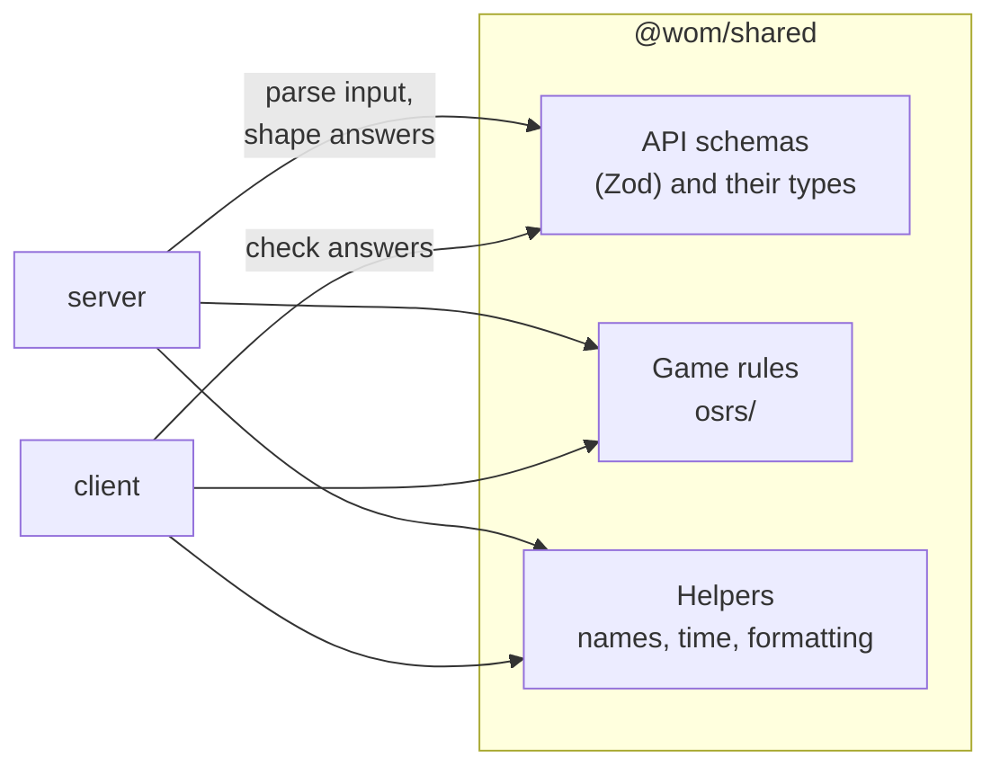

# Shared package architecture

`@wom/shared`: what the server and the client both need, so it's defined once. See the [root ARCHITECTURE.md](../ARCHITECTURE.md) for the bigger picture.

## Rules for this package

- **One entry point:** the package exports only `src/index.ts`, which re-exports every module. Import from `@wom/shared`, never from a file inside it.
- **Pure code only:** no Node or browser APIs, no I/O. Its only dependency is Zod.
- **Schemas first:** each API shape is a Zod schema, and its TypeScript type is inferred from it (`type Account = z.infer<typeof AccountSchema>`). The server builds answers to fit them and parses input with them; the client checks every answer with the same schema.
- **Limits live with their schema** and are exported for the client's inputs (`MESSAGE_MAX_LENGTH`, `NAME_MAX_LENGTH`), so the box and the server agree.

## Modules

| Module | Holds |
|---|---|
| `accounts.ts` | Account types and their labels (`ACCOUNT_TYPE_LABELS`, `ACCOUNT_TYPE_NOUNS`), `hasBank` and `canTrade`, source kinds, freshness, account names (`AccountNameSchema`), the account, lookup, add, change, refresh, file check and status schemas |
| `overview.ts`, `gains.ts`, `bank.ts`, `collectionLog.ts`, `goals.ts` | Each page's data schema; the bank's places (`BANK_PLACES`, `PLACE_NAMES`); This week's ranges; goal targets, `goalTitle` and progress; Temple's tabs and the steps to sync a log |
| `chat.ts` | Chats, messages, stored answers (an error names the AI that gave it; usage carries Claude's billing, or none), the stream's events (`ChatEvent`), the model lists and the AIs Settings can pick (`ProviderInfo`), and the stream format itself (`formatSse` on the server, `parseSse` in the browser) |
| `settings.ts` | The settings schema and defaults (the chosen AI, `ProviderIdSchema`, with its own model and effort; an empty model means the AI's default), and effort level names |
| `about.ts` | The About section (the `.env` values, the API keys only as set or not) and backups |
| `errors.ts` | The error answer (`{ error }`) and `errorMessage` |
| `names.ts` | `nameKey`: names compared ignoring case, with spaces, underscores, hyphens and non-breaking spaces the same (Wise Old Man's rule) |
| `time.ts` | Time constants, time zone checks (`effectiveTimeZone`: Automatic means the browser's zone), local days (`localDayKey`, `dayStart`, `dayRange`, `startOfLocalDay`) and `formatTime` ("5 minutes ago", "yesterday", "Oct 27, 2026") |
| `format.ts` | `formatNumber`, `formatCompact` (1.24M), `plural`, `capitalize`, `squeeze` |
| `ports.ts` | The default port (4747) and Vite's (5173) |
| `osrs/xp.ts` | The XP table to virtual level 126: `xpForLevel`, `levelForXp`, `MAX_XP` |
| `osrs/combat.ts` | `combatLevelOf` and the combat skills |
| `osrs/achievements.ts` | Diary areas and tiers, combat achievement tiers |
| `osrs/statsLayout.ts` | The in-game stats tab's order (`orderSkills`), and names between the hiscores and Wise Old Man (`womSkill`, `hiscoresSkill`, `metricName`, `isBoss`) |
| `osrs/equipment.ts` | Equipment slot names by number |
| `osrs/icons.ts` | Wiki icon file names for skills and bosses (`wikiIconFile`), the file pattern the server accepts, the progress rows' icons |

## Notable conventions

- **The skill and boss lists are never hard-coded where the data has them:** the hiscores' answer decides which skills exist (Sailing appeared without a code change). `orderSkills` only places known skills in the in-game order and appends any it doesn't know.
- **Times are ISO 8601 UTC strings** on the wire; formatting into a zone happens only for display, with `formatTime`. A day starts at midnight in the chosen zone (or when the clocks land, where they jump forward at midnight).
- **Written for people:** messages in the schemas are full sentences ("A name is 1 to 12 letters, numbers, spaces, hyphens or underscores…"), as they're shown as they are.
